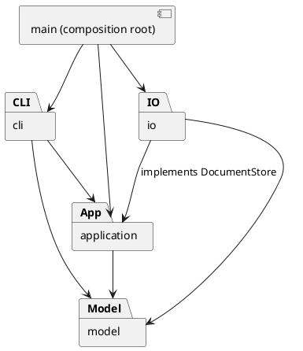

# Lab1 Phase 1：架构与开发记录

## 架构方案

### 模块划分

| 目录 | 职责 |
|---|---|
| `src/model` | 封装图形、容器树、文档、几何与样式规则；不依赖终端和文件系统 |
| `src/application` | 编辑会话、历史栈、命令接口与具体命令；协调模型与存储接口 |
| `src/io` | SVG/XML 解析与序列化、本地文件存储；实现应用层存储接口 |
| `src/cli` | 分词、命令分发、输出格式、逐行交互与脚本回放 |
| `src/main.ts` | 组合根：装配 CLI、会话与存储实现 |
| `test` | 模型、应用、文件读写与真实 CLI 验收 |

### 设计模式的选择

- **Command（必选）**：每条命令一个类，编辑命令在副本文档上执行，成功后记录前后快照。History 提供 undo/redo，失败不提交副本、不改变历史。
- **Composite**：Shape 为统一基类；Rect/Circle/Ellipse/Line/Text 为叶子，Group 为容器。Group 通过子节点的多态 move/scale 递归操作。
- **Memento**：文档深拷贝作为历史快照，准确还原删除的子树、父子关系、原始顺序及属性。第一阶段接受其空间开销；未来大文档可改为命令增量。
- **Factory**：ShapeFactory 集中创建六种内置类型。按名称分派仅限图形工厂与命令分发器；这两处明确列为后续插件注册机制的待重构点。
- **Dependency Inversion**：应用依赖 DocumentStore 接口，文件适配器实现该接口；测试用内存适配器替代磁盘。

### 依赖方向规则

1. model 只依赖本模块，不读取文件、不打印输出。
2. application 只依赖 model 与本模块接口，不导入 io/cli。
3. io 可依赖 model 与 application 的存储接口，不依赖 cli。
4. cli 可依赖 application/model，不直接访问文件系统；脚本文件读取在 main 装配层。
5. main 负责装配，可以依赖所有生产模块。测试可依赖所有被测模块。

### 变化点假设

| 变化点 | 当前处理与取舍 |
|---|---|
| 新图形、未来 box 插件 | 六种类型集中在 ShapeFactory；暂不实现动态插件及 box，避免超出阶段范围 |
| 新命令、未来 GUI/agent 输入 | 命令对象与终端分离，可以复用会话与模型 |
| 存储媒介变化 | DocumentStore 接口隔离文件存储 |
| 大型图形的历史开销 | 深快照优先保证正确性，未来可替换为增量撤销 |
| 更多 SVG 特性 | 明确支持边界；不静默丢弃不支持的图形与属性 |

### 规格歧义与当前决策

- group 选择不同父节点的对象时：目标新组放到最近公共祖先下，位置为最早被选分支的位置；成员按原文档前序顺序排列，不按参数顺序重排。
- front 为同级最后一个 SVG 子节点（最后绘制、最前显示）；back 为第一个。
- g 的样式写在 g 本身，遵循 SVG 继承；不覆盖子元素显式样式。
- 文档类成功执行后清空旧历史并锁定 undo/redo；下一次成功编辑解锁。只读 canvas 不锁定；失败命令不改变锁与历史。
- 无文档时允许 help；其余命令报 no document（init/read 例外）。
- 截止时间未在作业文件中提供，无法核实 final tag 是否早于课程截止时间。

## 过程记录

### 2026-10-20 · 迭代 1：需求与工程骨架

- 用户要求由 AI 开始第一阶段开发并建立 GitHub 仓库。阅读作业后，将 box 与插件加载排除在本阶段实现之外。
- 重点核对非一般编辑器行为：scale 也缩放坐标，根级容器禁止 ungroup，save 成功后锁定撤销。
- 选择 Command + Composite + 快照事务，优先保证失败无副作用与结构编辑完整撤销。
- 过程记录由 AI 基于实际开发行为撰写，不冒充学生人工评审；学生需在提交课程作业前自行阅读、验证和补充自己的理解。

## 一致性自查

开发中；完成时补充实际检查结果。

## 质量保证手段

计划：严格 TypeScript 编译；模型边界测试；命令会话与失败原子性测试；SVG 保存/读回一致性测试；真实 CLI 子进程回放作业案例；依赖方向静态检查。
