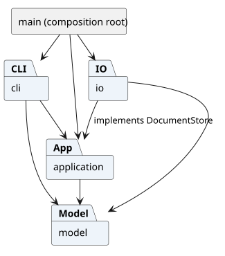
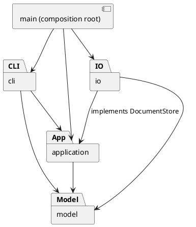

# Lab1 Phase 1：SVG 命令行编辑器课程作业

## 项目与仓库信息

**仓库地址：[https://github.com/Fake-WJ/svg-editor-cli](https://github.com/Fake-WJ/svg-editor-cli)**

本项目完成所提供 `phase_cli_1.md` 的第一阶段任务：使用 TypeScript 与面向对象方法实现 SVG 命令行编辑器，并与 AI 协作完成架构设计、编码、测试及过程记录。交付包括源代码、测试、命令示例、SVG 输出和本文档。

- 代码验收标签：[final](https://github.com/Fake-WJ/svg-editor-cli/tree/final)，对应提交 `df8a87e`。保留原标签，2026-10-31 的 README 补充位于 main。
- 检查记录：[final 对应版本的四平台组合验收](https://github.com/Fake-WJ/svg-editor-cli/actions/runs/39360206771)；[最新 CI 状态](https://github.com/Fake-WJ/svg-editor-cli/actions)。
- 仓库可见性：私有。教师或助教需要获得访问权限后才能克隆、查看代码和检查记录。
- 本阶段不实现图形界面、box 复合图形插件或动态插件系统；这些属于后续阶段。

## 安装、运行与验收

环境要求：Node.js 22 或以上、npm、Git，以及有权限访问该私有仓库的 GitHub 账号。

```sh
git clone https://github.com/Fake-WJ/svg-editor-cli.git
cd svg-editor-cli
npm ci
npm run check
npm run cli
```

进入 `svg>` 提示符后输入：

```text
init 800 600
create g scene
create rect r1 20 30 120 60 #4a90d9 in scene
create text t1 40 65 "Hello SVG" in scene
move scene 10 20
undo
redo
tree
save demo.svg
```

将生成的 `demo.svg` 拖入浏览器查看。输入 EOF 退出：Unix 终端通常为 Ctrl+D，Windows 终端可使用 Ctrl+Z 后回车。

运行课程“两节点流程图”案例：

```sh
npm run cli -- --script examples/flowchart.txt
```

结果写入 `examples/flowchart.svg`。也可以先执行 `npm run build`，再用 `node dist/main.js` 运行编译后的程序。

## 功能完成情况

| 类别 | 已实现内容 |
|---|---|
| 文档管理 | init、read、save、canvas；默认画布 800×600；SVG 保存和读回 |
| 图形类型 | rect、circle、ellipse、line、text、g；支持 create 的 in 子句 |
| 基础编辑 | delete、move、scale、set；容器和叶子统一操作 |
| 层级与顺序 | group、ungroup、addto、front、back；检查非法层级循环 |
| 信息展示 | tree、show、help；树中内联几何和样式属性 |
| 历史管理 | 一条编辑命令一个撤销单元；undo/redo；新编辑清空 redo |
| 输入与错误 | 双引号参数、注释行、唯一且大小写敏感的 ID；失败不提交状态 |
| 外部 SVG | 缺 ID 自动补齐并警告；读写异常提示；中文和 XML 特殊字符往返 |

重要行为：scale 同时缩放位置与尺寸；顶层容器禁止 ungroup；成功执行 init/read/save 或修改 canvas 后禁止 undo/redo，下一次成功编辑解禁；只读命令不进入历史。颜色省略时沿用 SVG 默认。

## 架构方案

### 模块划分

| 目录 | 职责 |
|---|---|
| `src/model` | 封装图形、容器树、文档、几何与样式规则；不依赖终端和文件系统 |
| `src/application` | 编辑会话、历史栈、命令接口与具体命令、文本展示格式；协调模型与存储接口 |
| `src/io` | SVG/XML 解析与序列化、本地文件存储；实现应用层存储接口 |
| `src/cli` | 分词、命令分发、错误输出、逐行交互与脚本回放 |
| `src/main.ts` | 组合根：装配 CLI、会话与存储实现 |
| `test` | 模型、应用、文件读写与真实 CLI 验收 |



可编辑 PlantUML 源文件：[architecture.puml](architecture.puml)。SVG 使用 PlantUML 1.2026.9 本地渲染。



### 设计模式的选择

- **Command（必选）**：每条命令一个类，编辑命令在副本文档上执行，成功后记录前后快照。History 提供 undo/redo，失败不提交副本、不改变历史。
- **Composite**：Shape 为统一基类；Rect/Circle/Ellipse/Line/Text 为叶子，Group 为容器。Group 通过子节点的多态 move/scale 递归操作。
- **Memento**：文档深拷贝作为历史快照，准确还原删除的子树、父子关系、原始顺序及属性。第一阶段接受其空间开销；未来大文档可改为命令增量。
- **Factory**：ShapeFactory 集中创建六种内置类型。按名称分派仅限图形工厂与命令分发器；这两处明确列为后续插件注册机制的待重构点。
- **Dependency Inversion**：应用依赖 DocumentStore 接口，文件适配器实现该接口；测试用内存适配器替代磁盘。

### 依赖方向规则

1. model 只依赖本模块，不读取文件、不打印输出。
2. application 只依赖 model 与本模块接口，不导入 io/cli。
3. io 可依赖 model 与 application 的存储接口，不依赖 cli。
4. cli 可依赖 application/model，不直接访问文件系统；脚本文件读取在 main 装配层。
5. main 负责装配，可以依赖所有生产模块。测试可依赖所有被测模块。

### 变化点假设

| 变化点 | 当前处理与取舍 |
|---|---|
| 新图形、未来 box 插件 | 六种类型集中在 ShapeFactory；暂不实现动态插件及 box，避免超出阶段范围 |
| 新命令、未来 GUI/agent 输入 | 命令对象与终端分离，可以复用会话与模型 |
| 存储媒介变化 | DocumentStore 接口隔离文件存储 |
| 大型图形的历史开销 | 深快照优先保证正确性，未来可替换为增量撤销 |
| 更多 SVG 特性 | 明确支持边界；不静默丢弃不支持的图形与属性 |

### 规格歧义与当前决策

- group 选择不同父节点的对象时：目标新组放到最近公共祖先下，位置为最早被选分支的位置；成员按原文档前序顺序排列，不按参数顺序重排。
- front 为同级最后一个 SVG 子节点（最后绘制、最前显示）；back 为第一个。
- g 的样式写在 g 本身，遵循 SVG 继承；不覆盖子元素显式样式。
- 文档类成功执行后清空旧历史并锁定 undo/redo；下一次成功编辑解锁。只读 canvas 不锁定；失败命令不改变锁与历史。
- 无文档时允许 help；其余命令报 no document（init/read 例外）。
- save 无参数使用最近一次成功 read/save 的路径；init 清除该路径。canvas 修改尺寸要求同时给出宽、高；init 仅给宽时高度取 600。
- 成功反馈要求摘要，不逐字复刻示例：move 显示增量，undo/redo 显示被撤销/重做的摘要；tree 使用完整属性名 width/height。
- SVG 颜色省略时不输出 fill/stroke。set 仅开放作业白名单；导入的字体、透明度、transform 等常见展示属性允许原样保存，但不开放 set 修改。
- 截止时间未在作业文件中提供，无法核实 final tag 是否早于课程截止时间。

## 过程记录

### 2026-10-20 · 迭代 1：需求与工程骨架

- 用户要求由 AI 开始第一阶段开发并建立 GitHub 仓库。阅读作业后，将 box 与插件加载排除在本阶段实现之外。
- 重点核对非一般编辑器行为：scale 也缩放坐标，根级容器禁止 ungroup，save 成功后锁定撤销。
- 选择 Command + Composite + 快照事务，优先保证失败无副作用与结构编辑完整撤销。
- 过程记录由 AI 基于实际开发行为撰写，不冒充学生人工评审；学生需在提交课程作业前自行阅读、验证和补充自己的理解。

### 2026-10-20 · 迭代 2：封装模型与树结构

- 实现 Shape 抽象基类、五种叶子类、Group 和 SvgDocument。几何与展示属性保存在私有字段内，外部只能通过方法修改；attributes/children 返回副本。
- 使用多态 move/scale 与 clone，避免在操作处重复按 tag 判断。
- 明确跨父级 group 的放置与排序规则，并测试 group 容器与子孙同时入选、addto 形成环、顶层 ungroup 拒绝。
- 首批 4 项模型测试通过后单独提交；此时创建私有 GitHub 仓库并推送，保留真实分步开发历史。

### 2026-10-20 · 迭代 3：Command 与事务历史

- 每个命令一个类，编辑类继承 EditCommand；EditorSession 在克隆文档上执行，仅成功后记录历史并替换当前文档。
- 检查了“先修改部分子图形，后因数值溢出失败”的边界。测试使用含 1e308 坐标的组进行整体缩放，确认原文档和 redo 栈不变。
- 覆盖删除子树后完整恢复、一次 group 只占一个撤销单元、撤销后新编辑清空 redo，以及 IO 失败不锁定历史。
- 10 项测试通过后提交命令与解析层。

### 2026-10-20 · 迭代 4：SVG 读写与真实 CLI

- XML 使用 @xmldom/xmldom 解析和转义，不用字符串拼接处理文本内容。缺 id 分配前先扫描全部显式 id，避免与文档后方的 rect1 冲突。
- 文件保存采用同目录临时文件写入后重命名；失败时清理临时文件，成功后才修改会话路径及历史。
- 严格编译首次发现 Node 类型未启用、XML localName 可能为空。补充 types 配置和 tagName 回退后通过。
- 增加真正启动编译后 dist/main.js 的子进程测试，回放作业第 6 节与 6.1 节。含预期错误的脚本继续运行，但退出码为 1。
- 自动安装的 TypeScript 7.0.2 已不提供旧版编译器 AST API，架构检查因此失败。读取已安装包的 exports 核实后，将 TypeScript 固定为 5.9.3，Node 类型固定到 22 系列，保持架构扫描可用。
- 将测试代码也加入类型检查，发现并纠正 assert.throws 的重载参数问题。最终本地 21 项测试全部通过。

### 2026-10-31 · 提交材料复核

- 核对本地工作区、GitHub 仓库地址和私有可见性；确认原 final 版本的四组 CI 均通过。
- 再次运行完整类型检查与 21 项测试，补充仓库地址、安装运行步骤、功能清单及提交说明。
- 保留原 final 标签与真实分步提交记录；本轮只补充文档，不改写先前验收版本。

## 一致性自查

1. **模块划分**：实际目录与方案一致。唯一职责调整为将 ShapeFormatter 放入 application，供 TreeCommand/ShowCommand 复用，避免应用层依赖 cli；已同步修改上方模块表。
2. **依赖方向**：`test/architecture.test.ts` 使用 TypeScript AST 扫描全部生产文件的 import，并检查一类一文件及类名/文件名一致。全部检查通过，未发现逆向依赖。模型与应用层不依赖 Node IO 或第三方包。
3. **按名字分派**：集中在 `ShapeFactory` 与 `CommandDispatcher` 的两个映射表；它们是后续插件化的明确待重构点。其余操作不使用 switch(tag)。
4. **封装与组合**：通过 Shape 方法操作几何/样式，通过 Group 管理子节点；不直接暴露可修改的几何字典与子节点数组。Group 用子节点多态执行变换。
5. **隔离边界**：`assignParent` 是供 Group 内部维护双向关系的内部用途方法；业务命令不调用它。EditorSession.document 供查询和内部协调使用，生产编辑入口统一走 EditCommand 的事务执行。

## 质量保证手段

执行 `npm ci` 安装锁定依赖；执行 `npm run check` 构建生产代码、检查生产与测试代码类型，再运行全部测试。

本地验证环境：Windows、Node.js 24.10.0。21 项测试通过：

| 测试文件 | 数量 | 验证内容 |
|---|---:|---|
| model.test.ts | 4 | 六种图形、组合变换、深拷贝、排序与层级约束、数值及 ID 校验 |
| commands.test.ts | 6 | 编辑命令、完整撤销/重做、失败原子性、IO 历史屏障、双引号与注释 |
| svg.test.ts | 6 | SVG 往返、补 id 冲突预防、XML 转义与中文、viewBox、非法输入、真实文件覆盖与失败 |
| cli.test.ts | 4 | 编译后程序回放作业案例、标准输入顺序、错误恢复、脚本参数和中文路径 |
| architecture.test.ts | 1 | 全部生产文件依赖方向、一类一文件、文件名与类名 |

CI 在 GitHub Actions 上配置 Windows / Ubuntu × Node 22 / 24 四组检查。功能验收提交 `60c8291` 的四组检查均已通过，见 [GitHub Actions 验收记录](https://github.com/Fake-WJ/svg-editor-cli/actions/runs/39359696835)。后续提交状态以仓库 Actions 页面实际结果为准。

验收映射：

- 文档命令 init/read/save/canvas：命令历史屏障测试、SVG 文件测试及 CLI 会话。
- 六类 create 与 in、delete/move/scale/set：模型测试、命令测试及流程图回放。
- group/ungroup/addto/front/back：结构编辑撤销测试、模型排序与循环约束测试。
- tree/show/help：命令查询测试及 CLI 输出检查。
- undo/redo：子树恢复、分支历史、IO 锁定、失败不破坏 redo。
- 失败无状态变化：多对象失败、数值溢出、读写失败与非法属性测试。

### 支持范围与已知限制

- 实现本阶段六种 SVG 元素；box 和插件加载不在本阶段范围内。带 `data-kind="box"` 的普通 g 导入后仍作为普通 Group 使用。
- 非完整 SVG 标准实现：path、use、defs、tspan、CSS/style、百分比尺寸、DTD 等不支持，遇到不支持的元素或属性会明确报错，不静默丢弃。
- 支持纯数字/px 画布尺寸和 viewBox；常见展示属性及 transform 可原样往返。move/scale 修改各图形的局部几何，不展开导入的 transform；跨组迁移/解组保留局部属性，不保证保留原祖先样式或变换导致的屏幕外观。这是外部复杂 SVG 的能力边界，作业示例的普通组合不受影响。
- 历史采用完整快照，空间开销随图形数与历史深度增长；第一阶段无历史条数上限。
- 批处理命令包含任意错误时最终退出码为 1，但仍执行后续命令；交互输入按行继续，EOF 退出。
- 浏览器预览不属于程序内核，生成的 `examples/flowchart.svg` 可直接在浏览器查看。
